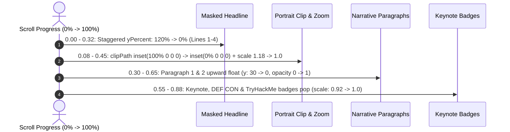

# About Section Architecture & Technical Documentation

The **About** section (`#about`) presents the professional background, security philosophy, keynote speaking credentials, and engineering arsenal for **Kaleeswaran S**.

Implemented using **GSAP ScrollTrigger**, **React / Framer Motion**, and **Tailwind CSS**, the section delivers an Awwwards-caliber interactive storytelling experience based on pure editorial motion design rather than artificial hacker tropes.

---

## 1. Visual Composition & Storytelling Hierarchy

The section is designed as a **narrative progression**:

$$\text{Who I am} \longrightarrow \text{What I believe} \longrightarrow \text{What I do} \longrightarrow \text{What I have achieved} \longrightarrow \text{What I build} \longrightarrow \text{How I think}$$

### Desktop (≥ 1024px) — Split-Screen Pinned Choreography
* **Left Column (~48%)**: Editorial narrative, 4-line masked typography reveals, bio paragraphs, and interactive keynote badges.
* **Right Column (~52%)**: 3D interactive architectural presentation frame with cursor-follow perspective, clip-path image reveal, and crisp metadata notations.

```
+-------------------------------------------------------------------------------+
| SPLIT-SCREEN PINNED STORYTELLING COMPOSITION (Desktop View)                   |
|                                                                               |
| [LEFT COLUMN: ~48%]                         [RIGHT COLUMN: ~52%]              |
| ┌ [MASKED REVEAL LINE 1] ─────────────────┐ +-------------------------------+ |
| │ I WORK AT THE                           │ | ┌───────────────────────────┐ | |
| │ INTERSECTION OF                         │ | │                           │ | |
| │ SECURITY AND                            │ | │  Kaleeswaran S Portrait   │ | |
| │ ENGINEERING.                            │ | │  (Padded Frame Container) │ | |
| └─────────────────────────────────────────┘ | │  (Masked Clip-Path Reveal)│ | |
|                                             | │  (3D Perspective Tilt)    │ | |
| Bio Paragraphs: Red Team Specialist,        | │  (Dynamic Light Glare)    │ | |
| Cloud Security Architect & Systems Engineer | └───────────────────────────┘ | |
|                                             +-------------------------------+ |
| Credentials: [Keynote Speaker] [DEF CON Coimbatore] [TryHackMe Top 4%]        |
+-------------------------------------------------------------------------------+
| TECHNICAL ARSENAL & CORE PROFICIENCIES                                        |
| [ALL DISCIPLINES]  [OFFENSIVE]  [ENGINEERING]  [CRAFT]                        |
|                                                                               |
| ┌──────────────────────┐  ┌──────────────────────┐  ┌──────────────────────┐  |
| │ Offensive Security   │  │ Full-Stack & Cloud   │  │ Creative Systems     │  |
| │ & Red Team           │  │ Engineering          │  │ & Craft              │  |
| └──────────────────────┘  └──────────────────────┘  └──────────────────────┘  |
+-------------------------------------------------------------------------------+
```

---

## 2. GSAP ScrollTrigger Motion Design Choreography

The section uses `gsap.context()` and `gsap.matchMedia()` with pinned `ScrollTrigger` scrubbing for desktop and progressive scroll reveals for mobile.

### Pinned Storytelling Scrub Timeline (Desktop `min-width: 1024px`):



| Phase | Scrub Range | Elements & Keyframes | Ease / Physics |
| :--- | :--- | :--- | :--- |
| **Headline Line-by-Line Reveal** | `0.00` – `0.32` | `yPercent: 120% → 0%`, `opacity: 0 → 1`, `stagger: 0.06` across 4 headline lines. | `power3.out` |
| **Portrait Clip-Path & Zoom** | `0.08` – `0.45` | `clipPath: inset(100% 0 0 0) → inset(0% 0 0 0)`, `scale: 1.18 → 1.0`. | `power2.inOut` |
| **Narrative Bio Stagger** | `0.30` – `0.65` | Bio paragraphs 1 & 2 `y: 30px → 0px`, `opacity: 0 → 1`, `stagger: 0.12`. | `power2.out` |
| **Credential Badges Pop** | `0.55` – `0.88` | Keynote, DEF CON & TryHackMe badges `y: 20px → 0px`, `scale: 0.92 → 1.0`. | `back.out(1.8)` |
| **Arsenal Stagger Reveal** | `start: 'top 82%'` | Header `y: 30px → 0px`, 3 competency cards `y: 40px → 0px`, `stagger: 0.15s`. | `power3.out` |

---

## 3. Interactive 3D Physics & Micro-Interactions

| Element | Interaction | Physics / Implementation |
| :--- | :--- | :--- |
| **Desktop Portrait Frame** | Cursor-Follow 3D Tilt | Normalized coordinates `[-1, 1]` translate into subtle `rotateX` / `rotateY` (max ±3.5°) with smooth spring return on `onMouseLeave`. |
| **Dynamic Light Glare** | Radial Spotlight | Interactive `radial-gradient` moves with cursor coordinates to simulate light reflecting on high-grade optical glass. |
| **Speaking & Credential Badges** | Tactile Lift & Glow | `hover:-translate-y-1`, subtle gold border transition (`#c59b6d/30 → #dfb88e`), and icon scaling. |
| **Competency Cards** | Elevation & Accent Expansion | `group-hover:-translate-y-1.5`, top signal line expands from `w-12` to `w-20`, icon container shifts to solid bronze. |
| **Filter Pills** | Spring Layout Switch | Framer Motion `layout` and active shadow pills for immediate tactile category filtering. |

---

## 4. Content Architecture & Competencies

### 1. Editorial Headline:
* `I WORK AT THE` (`#f7f4ee`)
* `INTERSECTION OF` (`#c59b6d`)
* `SECURITY AND` (`#f7f4ee`)
* `ENGINEERING.` (`#dfb88e`)

### 2. Narrative Bio:
* **Philosophy**: Systems fail at edge cases; understanding how adversaries operate allows engineering truly resilient software.
* **Discipline**: Treats security not as an afterthought or compliance checkbox, but as an architectural discipline woven into every layer.

### 3. Speaking & Credential Badges:
* **Technical Keynote Speaker**: Public keynote delivery and security workshops.
* **DEF CON Group Coimbatore**: Offensive security community leadership and research.
* **TryHackMe Top 4%**: Verified global security ranking.

### 4. Technical Competency Arsenal (9 Disciplines):
* **Cybersecurity (`cybersecurity`)**: Offensive security, red teaming, VAPT, web & API security, network & cloud security, Active Directory, Linux/Windows security, threat modeling, auditing & research.
* **Exploit Development & Offensive Security (`offensive`)**: Exploit dev, vulnerability research, binary & web exploitation, reverse engineering, shellcode, PoC dev, privilege escalation, lateral movement, persistence & C2, attack surface analysis, CTF.
* **Security Tools & Technologies (`tools`)**: Burp Suite, Nmap, Metasploit Framework, Wireshark, Gobuster, ffuf, sqlmap, Hydra, John the Ripper, Hashcat, Netcat, Ghidra, pwndbg, GDB, Docker, Git, GitHub, Linux, Bash, Python automation.
* **Cloud & AWS (`cloud`)**: **AWS Certified Cloud Practitioner — In Progress** badge. Compute (EC2, Lambda, ECS, EKS, ECR, Beanstalk, Auto Scaling), Storage/DB (S3, RDS, DynamoDB, Backup), Networking (VPC, CloudFront, Route 53, ELB), Security/Identity (IAM, Secrets Manager, KMS, WAF, Shield, ACM, GuardDuty, Security Hub, Inspector), Governance (CloudWatch, CloudTrail, Systems Manager, CloudFormation, Organizations, Config), Integration (SNS, SQS, EventBridge, Step Functions, API Gateway), CI/CD (CodePipeline, CodeBuild, CodeDeploy).
* **Full-Stack Development (`fullstack`)**: Full-stack web & app development, Java, Spring Boot, React.js, Node.js, Express.js, TypeScript, JavaScript, Python (Basic), HTML5, CSS3, REST APIs, microservices, OOP, DSA.
* **Databases & Data Technologies (`databases`)**: MySQL, MariaDB, PostgreSQL, MongoDB, Redis in-memory caching, database design, SQL & NoSQL query engineering, performance optimization.
* **Messaging & Distributed Systems (`distributed`)**: Apache Kafka event streaming, event-driven architecture, message queues, distributed systems scalability, asynchronous processing.
* **Programming & Scripting (`programming`)**: Java, Python, JavaScript, TypeScript, C, C++, Bash, SQL.
* **DevOps & Engineering (`devops`)**: Git, GitHub, Docker, CI/CD, Linux, REST APIs, microservices, containerization, infrastructure fundamentals, cloud deployment, application security.

---

## 5. Responsive & Accessibility Strategy

* **Desktop (≥ 1024px)**: Pinned GSAP ScrollTrigger timeline with split-screen composition and 3D mouse tracking.
* **Mobile / Tablet (< 1024px)**: Natural unpinned vertical flow with viewport-triggered ScrollTrigger reveals for portrait, typography lines, narrative, and badges.
* **Reduced Motion**: Automatically detects `prefers-reduced-motion: reduce` and sets all elements to their final resting state immediately with zero delay.
